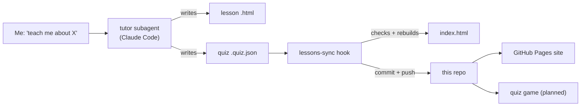

# lessons

> Short, illustrated lessons for beginners (CS, maths, physics, chemistry…), each with a quiz, written by an AI tutor while I build my projects and published automatically.

<!-- TODO: demo GIF (30-60 s): scroll through a lesson, open a few quiz answers, switch to dark mode. Save it as docs/demo.gif, then replace this comment with:  -->


**📚 Read them: [e54sacha.github.io/lessons](https://e54sacha.github.io/lessons/)**

## Features

- **Read short lessons** on one idea at a time: the idea, key words, how it works, a worked example, pros and limits, other ways.
- **Learn from pictures:** diagrams built from cards and icons, drawings, real math formulas and tip boxes, in light and dark mode, on desktop and phone.
- **Test yourself** with a quiz at the end of each lesson: open questions, true or false, multiple choice and fill in the blank, each answer hidden until you click, with an explanation.
- **Browse by subject and topic** from a home page that updates itself with every new lesson.
- **Reuse the quizzes** in your own app: every quiz is also a JSON file with a documented schema.

## Architecture



Lessons are written by the `tutor` subagent of my [claude-dev-toolkit](https://github.com/E54Sacha/claude-dev-toolkit) plugin. When it saves a quiz, a hook checks it against the schema (right folder, allowed subject, valid answers, safe pictures), rebuilds the home page, then commits and pushes. A broken quiz is never published: the hook sends the errors back to the tutor, which fixes the file.

## Run it locally

**Requirements:** a web browser and an internet connection (icons and formulas load from a CDN).

```bash
git clone https://github.com/E54Sacha/lessons.git
cd lessons
# open index.html in your browser, or serve the folder:
python -m http.server 8000      # then visit http://localhost:8000
```

There is no build step. The quiz checks and their tests live in [claude-dev-toolkit](https://github.com/E54Sacha/claude-dev-toolkit) (`node --test tests/`).

## Project structure

```
index.html                               # home page, rebuilt automatically with every new lesson
<subject>/<topic>/<lesson>.html          # a lesson page
<subject>/<topic>/<lesson>.quiz.json     # the same quiz, as data
assets/lesson.css                        # shared style + illustration kit (flows, timelines, layers…), light/dark
assets/lesson.js                         # formulas (KaTeX) and the "show all answers" button
subjects.json                            # allowed subjects: cs, maths, physics, chemistry, finance, general-knowledge
schema/quiz.schema.json                  # the format of every .quiz.json
.lessons-repo                            # marker file: the hook only acts inside this repo
```

## Quiz format

Each `.quiz.json` follows [schema/quiz.schema.json](schema/quiz.schema.json). Every question has an `id`, a `type`, the `question`, the `answer` and an `explanation`:

| `type` | `answer` | Extra fields |
|---|---|---|
| `open` | model answer (text) | |
| `true_false` | `true` or `false` | |
| `multiple_choice` | index of the correct option, 0-3 | `options` (4 strings) |
| `fill_blank` | the missing word | `accept` (other spellings) |

A question can also have a `figure`: one self-contained inline SVG picture (inline colours, no scripts), the same one shown in the lesson.

## What I learned

- **Validate data at the boundary:** checking each quiz before it is pushed means the site and the game never receive broken data. <!-- TODO: check this is true for you -->
- **Automation beats instructions:** the tutor can't run commands, so a hook does the commit and push every time, without relying on the AI to remember. <!-- TODO: check this is true for you -->
- **Simple HTML/CSS can beat a diagram library:** the Mermaid flowcharts didn't render reliably, while hand-built cards with icons always look the same. <!-- TODO: check this is true for you -->

## What I'd do differently

- The lessons depend on CDNs for icons and formulas; bundling them would make the pages work offline.
- Only the quiz file triggers a publish: a lesson page edited by hand has to be committed manually.
- The quiz game that will use these questions isn't built yet.

## License

Content: [CC BY 4.0](https://creativecommons.org/licenses/by/4.0/) © 2026 E54Sacha. You can reuse and adapt it, with credit.
